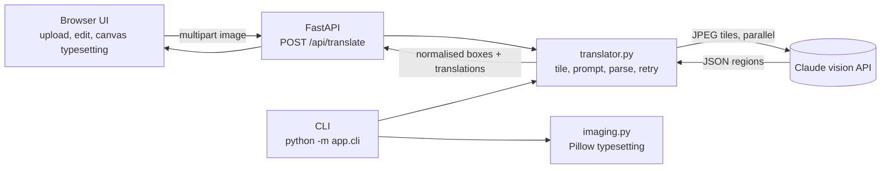

# 📖 Manhwa Translation Engine


Turn raw Korean manhwa and webtoon scans into clean, typeset English pages. Upload a page, and a vision LLM finds every speech bubble, translates it, and the app covers the original text and sets the English in its place. Every line stays editable before you export.

<!-- Add a before/after screenshot or GIF here: docs/demo.gif -->
<!--  -->

## Why this exists

Fan translation is slow because one page is really four jobs in a row: find the text, translate it, erase the Korean, and typeset the English. This project automates all four and keeps a human in the loop for the last mile.

The interesting engineering is in treating the LLM as an unreliable component. Model output is parsed defensively, validated against a schema, retried once on malformed JSON, and upstream failures are mapped to clear HTTP errors instead of crashing the request.

## Features

- **Full pipeline:** detect text, translate, clean the bubble, typeset, export PNG
- **Webtoon-aware:** very tall strips are cut into equal tiles and translated in parallel with bounded concurrency
- **Controllable translation:** style presets (natural, literal with honorifics, punchy), a glossary for consistent character names, optional sound-effect handling
- **Human in the loop:** edit any line live, toggle individual regions off, flip between original and translation
- **Resilient LLM handling:** Pydantic-validated output, tolerant JSON extraction, automatic retry, error mapping for 401, 413, 415, 429, 502 and 503
- **Secure by default:** the API key lives on the server only
- **Production hygiene:** typed settings, offline unit tests with a fake LLM client, ruff, GitHub Actions CI, Docker

## How it works

A page arrives as an image. If it is a tall webtoon strip, it is first cut into equal-height tiles so the model never sees a distorted sliver. Each tile is sent to Claude as a base64 JPEG together with a prompt that asks for strict JSON: a bounding box, the Korean text, the English translation and a region type for every piece of text.

The replies are parsed, validated and stitched back into one list of regions. Boxes are converted to fractions of the full page, so the same result can be rendered at any resolution. The browser then paints each region over the original: it samples the bubble's edge colour for a clean fill, wraps the English text, and shrinks the font until it fits.



### Design decisions

| Decision | Reason |
|---|---|
| Boxes returned as fractions (0 to 1) | Browser, CLI and server can render at any resolution |
| Equal-height tiles | Avoids a tiny trailing slice that confuses the model |
| Schema validation plus one retry | LLM output is untrusted input; failure becomes a clear 502 |
| Server-side API key | Nothing sensitive reaches the browser; rate limiting and auth are easy to add later |
| Injectable client in `translate_image` | Tests run offline with a fake client |

## Tech stack

Python 3.12, FastAPI, Pydantic, Anthropic SDK (vision), Pillow, vanilla JS and Canvas, pytest, ruff, Docker, GitHub Actions.

## Getting started

**Prerequisites:** Python 3.12+ and an [Anthropic API key](https://console.anthropic.com/).

```bash
git clone https://github.com/<you>/manhwa-translator.git
cd manhwa-translator
cp .env.example .env        # then set ANTHROPIC_API_KEY
make install
make run                    # http://127.0.0.1:8000
```

**Docker**

```bash
cp .env.example .env
make docker                 # http://localhost:8000
```

**CLI**

```bash
cd backend
python -m app.cli ../samples/page01.jpg -o page01_en.png --glossary "서준 = Seojun" --sfx
```

## Configuration

All settings are environment variables (or entries in `.env`).

| Variable | Default | Purpose |
|---|---|---|
| `ANTHROPIC_API_KEY` | none | Required |
| `MODEL` | `claude-sonnet-5-5` | Model used for vision translation |
| `MAX_TOKENS` | `4096` | Output limit per tile |
| `SLICE_HEIGHT` | `1500` | Tile height for tall strips |
| `MAX_WIDTH` | `1000` | Images are downscaled to this width |
| `MAX_UPLOAD_MB` | `15` | Upload size limit |
| `CONCURRENCY` | `3` | Parallel tile requests per page |

## API

`POST /api/translate` accepts multipart form data: `image` (required), plus optional `style`, `glossary` and `include_sfx`.

```json
{
  "width": 1000,
  "height": 2400,
  "tiles": 2,
  "model": "claude-sonnet-5-5",
  "regions": [
    { "box": [0.12, 0.08, 0.30, 0.06], "korean": "안녕", "english": "Hello", "type": "speech" }
  ]
}
```

`GET /api/health` returns status, the model in use and whether a key is configured. Interactive docs are served at `/docs`.

## Project structure

```
backend/
  app/
    main.py         API routes and error mapping
    translator.py   tiling, prompt, parsing, retry, parallel calls
    imaging.py      tiling and Pillow typesetting
    schemas.py      Pydantic models
    config.py       settings
    cli.py          command-line entry point
  tests/            parsing, tiling, rendering and API tests
frontend/           index.html, styles.css, app.js
.github/workflows/  CI (ruff and pytest)
Dockerfile, docker-compose.yml, Makefile
```

## Testing

```bash
make test    # 11 tests, no network or API key needed
make lint    # ruff
```

## Troubleshooting

| Symptom | Fix |
|---|---|
| "ANTHROPIC_API_KEY is not set" in the UI | Add the key to `.env` and restart the server |
| 429 errors | Lower `CONCURRENCY` or wait and retry |
| 502 "did not return valid JSON" | Retry the page; try a smaller `SLICE_HEIGHT` for very dense pages |
| Boxes slightly off or a bubble missed | Edit the text in the side panel, or untick the region |

## Limitations and roadmap

- [ ] Add an OCR or text-detector pass (EasyOCR or PaddleOCR) for pixel-accurate boxes
- [ ] Replace the flat bubble fill with OpenCV inpainting for text drawn over artwork
- [ ] Draggable and resizable boxes in the editor
- [ ] Chapter-level zip export and translation memory across pages
- [ ] Background job queue and per-user rate limiting for a hosted deployment

## Responsible use

Only translate material you have the right to use. Pages are sent to the Anthropic API for processing.

## License

MIT. See [LICENSE](LICENSE).
