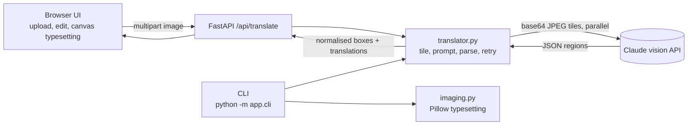

# Manhwa Translation Engine


An AI-powered translator that turns raw Korean manhwa/webtoon scans into typeset English pages. A FastAPI service sends each page to a vision LLM (Claude), gets back structured text regions with translations, and the web UI (or a CLI) cleans the bubbles and typesets the English on top.

## Features

- **End-to-end pipeline:** detect text, translate, clean the bubble, typeset, export PNG
- **Webtoon-aware:** tall strips are tiled automatically and translated in parallel with bounded concurrency
- **Controllable output:** translation style presets, per-series glossary for consistent character names, optional SFX handling
- **Human in the loop:** edit any translated line live, toggle regions off, compare with the original
- **Robust LLM handling:** schema-validated responses (Pydantic), fenced-JSON tolerant parsing, automatic retry on malformed output, mapped upstream errors (401/429/5xx)
- **Secure by design:** the API key lives only on the server, never in the browser
- **Engineering hygiene:** typed config, unit tests with a fake LLM client, ruff lint, GitHub Actions CI, Docker

## Architecture



Key design decisions:

| Decision | Why |
|---|---|
| Boxes returned as fractions (0-1) of the full page | Frontend, CLI and server can all render at any resolution |
| Tiles of equal height instead of fixed-height cuts | No tiny trailing sliver that confuses the model |
| Structured JSON with validation and one retry | LLM output is untrusted input; failures degrade to a clear 502 instead of a crash |
| Server-side key, thin client | Prevents key leakage; makes rate limiting and auth easy to add |
| Injectable client in `translate_image` | Tests run offline with a fake client |

## Quick start

```bash
git clone https://github.com/<you>/manhwa-translator.git && cd manhwa-translator
cp .env.example .env          # add your ANTHROPIC_API_KEY
make install && make run      # http://127.0.0.1:8000
```

Or with Docker: `make docker`.

CLI:
```bash
cd backend && python -m app.cli ../samples/page01.jpg -o page01_en.png --glossary "서준 = Seojun"
```

## API

`POST /api/translate` (multipart): `image`, optional `style`, `glossary`, `include_sfx`.

```json
{ "width": 1000, "height": 2400, "tiles": 2, "model": "claude-sonnet-5-5",
  "regions": [ { "box": [0.12, 0.08, 0.30, 0.06], "korean": "안녕", "english": "Hello", "type": "speech" } ] }
```

`GET /api/health` reports status and whether a key is configured. Interactive docs at `/docs`.

## Project layout

```
backend/app/    config, schemas, translator (LLM pipeline), imaging (tiling and typesetting), main (API), cli
backend/tests/  parsing, tiling, rendering, API contract tests (no network needed)
frontend/       dependency-free UI (HTML, CSS, JS) served by FastAPI
.github/        CI: lint and tests on every push
```

## Testing

```bash
make test    # pytest, uses a fake LLM client
make lint    # ruff
```

## Limitations and roadmap

- Bounding boxes come from the model and are approximate; add a dedicated OCR/text-detector pass (EasyOCR or PaddleOCR) for pixel-accurate boxes
- Replace flat bubble fill with OpenCV inpainting for text on artwork
- Draggable box editing, chapter-level zip export, translation memory across pages
- Background job queue and per-user rate limiting for a hosted deployment

Respect copyright: only translate material you have the right to use.

## License

MIT
